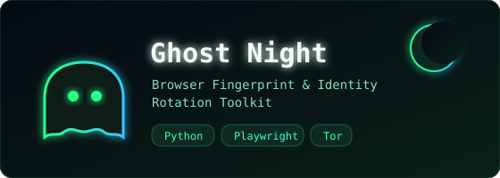
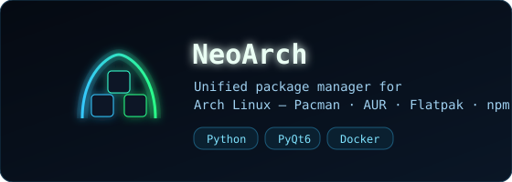

<div align="center">


<a href="https://www.linkedin.com/in/sanjayadanushka712/"></a>
<a href="https://github.com/sanjayadanushka712/Ghost-Night"></a>
<a href="https://zenodo.org/records/16220684"></a>


</div>


<div align="center">

### <code>whoami</code>

```console
$ whoami
sanjaya@dev-whale

$ cat profile.json
{
  "role"      : "Software Engineer + DevOps",
  "focus"     : ["cloud-native", "automation", "security", "open education"],
  "community" : "Open Source Developers Community (OSDC)",
  "author_of" : "The Art of Software Engineering",
  "certified" : "Aviatrix ACE Multicloud Network Associate",
  "location"  : "Badulla District, Uva Province, Sri Lanka",
  "mission"   : "empower underserved communities through open education"
}

$ echo $MISSION
building not just software, but sustainable systems for others
```

</div>


## Stack

<div align="center">


</div>


## Featured Projects

<div align="center">

<a href="https://github.com/sanjayadanushka712/Ghost-Night"></a>
<a href="https://github.com/sanjayadanushka712"></a>

<br/>

<a href="https://github.com/sanjayadanushka712/Ghost-Night"></a>


</div>

<table>
<tr>
<td width="50%" valign="top">

**Dracula-Deep** — a VS Code theme *engineered*, not colored. WCAG-contrast syntax palette, six-level bracket nesting, automated contrast checks.
`TypeScript` · `VS Code API`

</td>
<td width="50%" valign="top">

**TravelNest** — modern **Flutter** travel app. Glassmorphism cards, favorites, real-time search, animations.
`Flutter` · `Dart`

</td>
</tr>
<tr>
<td width="50%" valign="top">

**Movie API** — full-featured **Node + Express** REST API. Auth, TMDB search, ratings, uploads, recommendations.
`Node.js` · `Prisma` · `PostgreSQL`

</td>
<td width="50%" valign="top">

**Portfolio** — a responsive portfolio site built in under an hour during a tea-time coding session.
`HTML` · `CSS` · `JavaScript`

</td>
</tr>
</table>


## Activity

<div align="center">


<br/>


<br/><br/>

<!-- contribution snake (auto-generated daily by .github/workflows/generate-snake.yml) -->
<picture>
  <source media="(prefers-color-scheme: dark)" srcset="https://raw.githubusercontent.com/sanjayadanushka712/sanjayadanushka712/output/github-snake-dark.svg" />
  <source media="(prefers-color-scheme: light)" srcset="https://raw.githubusercontent.com/sanjayadanushka712/sanjayadanushka712/output/github-snake.svg" />
  
</picture>

</div>


## Books &amp; Publications

| | Title | Where | Year |
|:-:|---|---|---|
| 📘 | *The Art of Software Engineering* | open source | — |
| 🔐 | *A Guide to Cyber Ethics* | [Zenodo](https://zenodo.org/records/16220684) | 2025 |
| 📄 | *Agile Methodologies Impact on Software Quality and Clients Satisfaction* | Zenodo | 2025 |


## Education &amp; Certifications

- 🎓 **B.ICT (Hons) — Software Engineering** · Asia e University *(2023–2027)*
- 🎓 **Computer Science** · Open Source Society University *(2023–2027)*
- ☁️ **ACE Multicloud Network Associate** · Aviatrix
- 💻 **Software Engineer Certificate** · HackerRank
- 🧾 **Ultimate YAML Course (YAML · JSON · JSONPath)** · Udemy
- 🏅 **Professor Sarath Amunugama Gold Award** + **Batch Top Achiever** · IMBS Green Campus *(2023)*


<div align="center">

### Let's build something good. 🐋

*Lone wolf doesn't mean alone — it means independent, focused, and relentless in pursuit of impact.*


</div>
