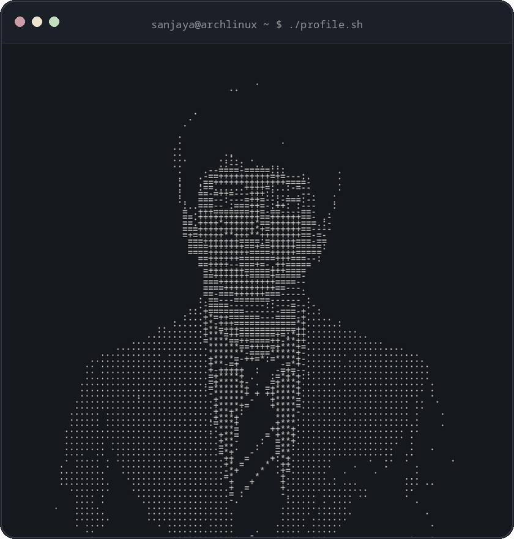
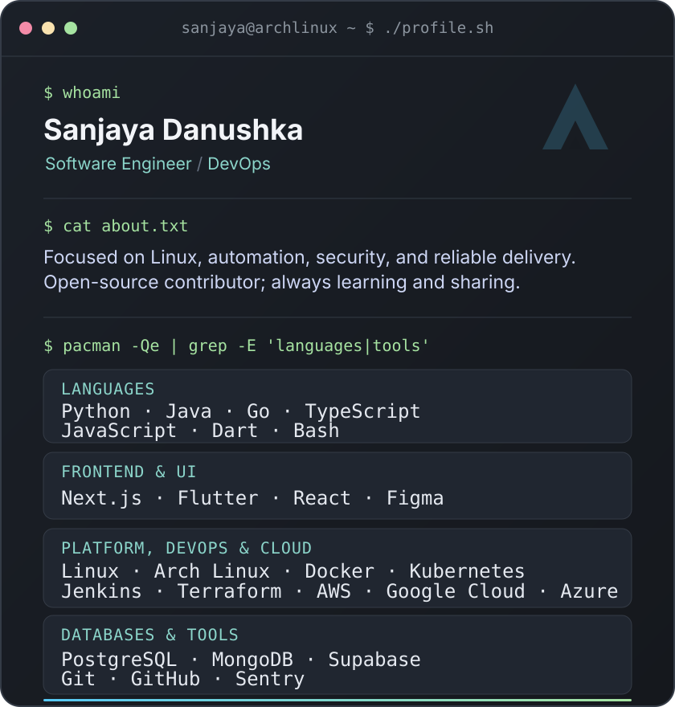

<h2><code>sanjaya@github ~ $ whoami</code></h2>

<strong>Software Engineer · DevOps · Arch Linux enthusiast</strong>

Building reliable software through automation, security, and open source.

&nbsp;&nbsp;&nbsp;&nbsp;&nbsp;&nbsp;

  
  
  

