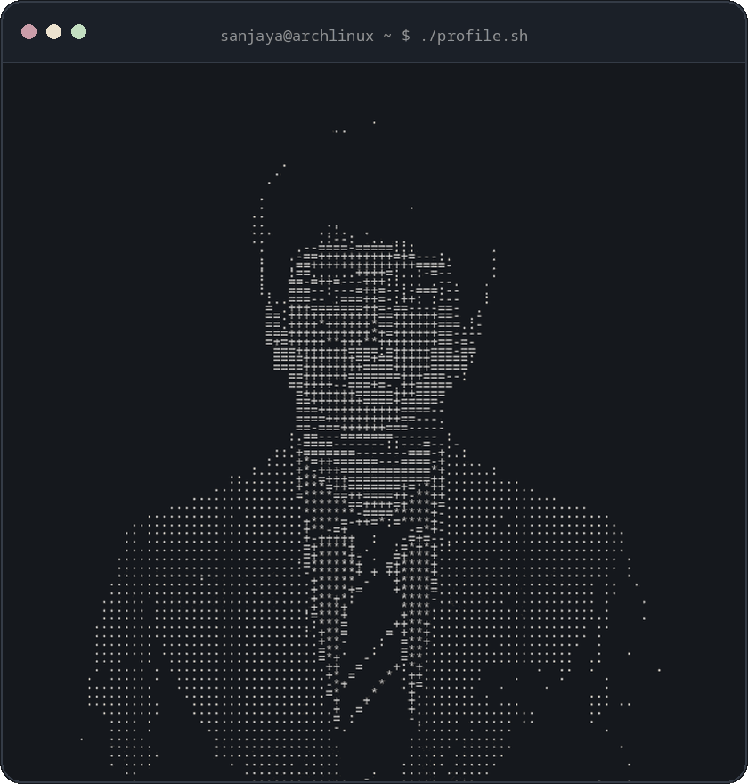

<h1><code>sanjaya-danushka@arch ~ $ whoami</code></h1>

<strong>Software Engineer · DevOps · Linux Enthusiast</strong>

Building useful Linux tools and dependable automation through open source.

  
  

## <code>$ cat ~/.config/skills.list</code>

  <code>Skills: Bash • Go • Java • TypeScript • Python • PyQt • Next.js • React • Flutter • Figma</code> 
  <code>Stack: Linux • Docker • Kubernetes • Jenkins • Git • Nginx • Prometheus • Grafana • PostgreSQL • MongoDB</code>

## <code>$ git log --oneline --graph</code>

  

## <code>$ cat ./connect.sh</code>

  
  
  <!--  -->
  

## <code>$ ls -la ~/github-profiles/</code>

<table>
  <tr>
    <td align="left">
      <h3><code>01. professional/</code></h3>
      <code>Purpose: Professional Engineering</code>  
      <code>Focus: Software Engineering</code> 
      <code>Focus: DevOps & Cloud</code> 
      <code>Focus: Open Source</code>  
      
       
      <code>github.com/sanjayadanushka712</code>
    </td>
    <td align="left">
      <h3><code>02. personal/</code></h3>
      <code>Purpose: Personal & Hobby Projects</code>  
      <code>Focus: Side Projects</code> 
      <code>Focus: Experimentation</code> 
      <code>Focus: Technology Exploration</code>  
      
       
      <code>github.com/Sanjaya-Danushka</code>
    </td>
  </tr>
</table>

<code>$ echo "Two spaces. One passion for building."</code>

   
  <code>echo "We don’t build toys. We build for the real world. — Sanjaya Danushka"</code>

