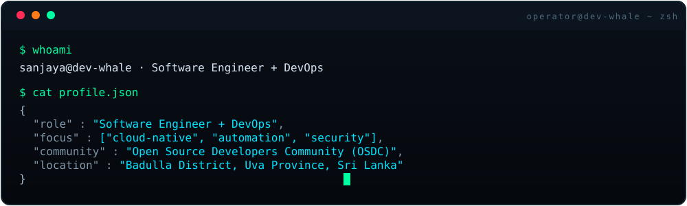

 

<!-- contribution snake (auto-generated by .github/workflows/generate-snake.yml) -->
<picture>
  <source media="(prefers-color-scheme: dark)" srcset="https://raw.githubusercontent.com/sanjayadanushka712/sanjayadanushka712/output/github-snake-dark.svg" />
  <source media="(prefers-color-scheme: light)" srcset="https://raw.githubusercontent.com/sanjayadanushka712/sanjayadanushka712/output/github-snake.svg" />
  
</picture>

