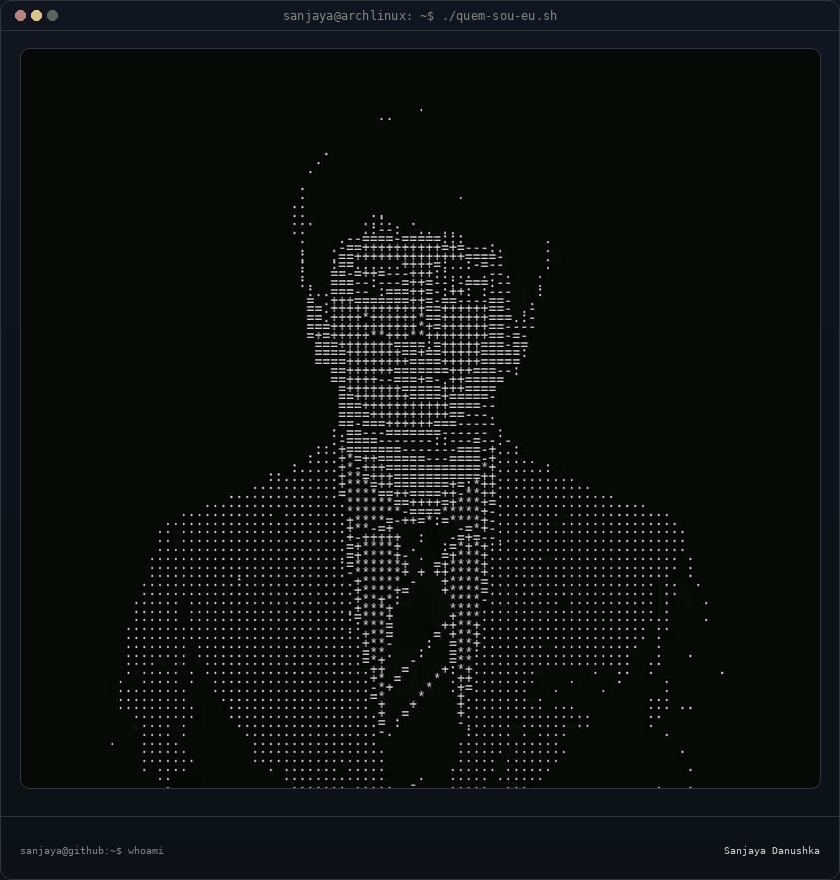

<h3><code>sanjaya@github ~ $ ./contribuicoes.sh</code></h3>

  

<h3><code>sanjaya@github ~ $ ./quem-sou-eu.sh</code></h3>
<table>
<tr>
<td valign="top"></td>
<td valign="top"></td>
</tr>
</table>

 

<h3><code>sanjaya@github ~ $ ./sobre-mim.sh</code></h3>

<strong>Software Engineer &amp; DevOps</strong>

Focused on Linux, automation, security and building scalable end-to-end systems — from design &amp; development to containerization, deployment and monitoring.

Open-source contributor, driven by automation, reliability and sharing knowledge with the community.

 

<h3><code>sanjaya@github ~ $ ./tecnologias-e-ferramentas.sh</code></h3>

<h3>Languages</h3>

<h3>Frontend &amp; UI</h3>

<h3>Platform, DevOps &amp; Cloud</h3>

<h3>Databases &amp; Tools</h3>

 

<h3><code>sanjaya@github ~ $ ./contato.sh</code></h3>

