<h1><code>sanjaya-danushka@arch ~ $ whoami</code></h1>

<strong>Software Engineer · DevOps · Linux Enthusiast</strong>

Building useful Linux tools and dependable automation through open source.

  
  

## <code>$ cat ~/.config/skills.list</code>

           
       
   
 

## <code>$ git log --oneline --graph</code>

  

## <code>$ cat ./connect.sh</code>

  
  
  
  

